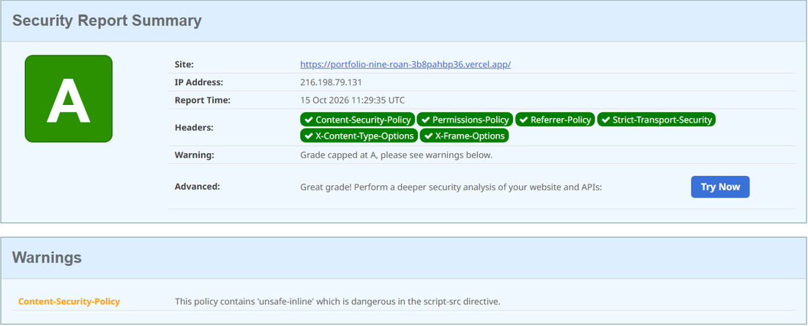

# Portfolio - Deon Grover

**Live: [portfolio-nine-roan-3b8pahbp36.vercel.app](https://portfolio-nine-roan-3b8pahbp36.vercel.app)**

[](https://github.com/DeGro19/Portfolio/actions/workflows/ci.yml)

A personal site for a cybersecurity graduate, built from scratch rather than
from a template. The goal was a site that **demonstrates** rather than
describes: the headers are hardened, the contact form is defended, the
decisions are written down, and the code is public so any claim here can be
checked.

---

## Contents

- [How it was built](#how-it-was-built)
- [Design](#design)
- [Security](#security)
- [Accessibility](#accessibility)
- [Performance](#performance)
- [Running it locally](#running-it-locally)
- [Project structure](#project-structure)
- [Testing and CI](#testing-and-ci)

---

## How it was built

| Area      | Choice                  | Why                                                                                                                     |
| --------- | ----------------------- | ----------------------------------------------------------------------------------------------------------------------- |
| Framework | Next.js 16 (App Router) | Server Components mean the static parts ship zero JS                                                                    |
| Language  | TypeScript              | Catches the class of bugs that come from renaming a field and missing a usage                                           |
| Styling   | Tailwind CSS v4         | Styles live next to the markup, so there is no dead CSS. v4's native CSS variables are what make the theme switch cheap |
| Theming   | `next-themes`           | Handles the hard part: setting the theme class before first paint                                                       |
| Content   | Typed data modules      | The CV lives in `src/lib/cv-data.ts` as structured data, so pages stay presentational and one edit updates everywhere   |
| Email     | Resend                  | Contact form delivery                                                                                                   |
| Hosting   | Vercel                  | Static prerendering with Partial Prerendering                                                                           |


---

## Design

- **Statically prerendered** with a sticky header whose backdrop is masked to
  fade out at the bottom, so content dissolves under it rather than hitting a
  hard edge.
- **Active section tracking** via `IntersectionObserver` rather than a scroll
  listener, so the browser does the work off the main thread instead of
  recalculating layout on every frame.
- **Theme cross-fade done properly.** The first version transitioned `*`, which
  meant ~590 simultaneous transitions and a visible stutter. The eight theme
  colours are now registered with `@property`, which makes them
  interpolatable, so the fade runs as a single transition on `<html>` and
  every descendant inherits the interpolated values.
- **Dot-grid background and a warm radial wash** anchored to the top of the
  document so it sits behind the sticky header with no seam.
- **Scroll progress bar** driven by a spring, which is also why the page
  scrollbar is hidden: position is already reported.

---

## Security

All responses carry a hardened header set, applied in
[`next.config.ts`](./next.config.ts):

```
Content-Security-Policy      Strict-Transport-Security
X-Content-Type-Options       Referrer-Policy
Permissions-Policy           X-Frame-Options
Cross-Origin-Opener-Policy
```



> Scan it yourself at [securityheaders.com](https://securityheaders.com).

### Why A and not A+

The single warning is `'unsafe-inline'` in `script-src`. That is a deliberate
trade rather than an oversight.

An A+ needs a **nonce-based CSP**, where every inline script carries a fresh
random token. Nonces must be generated **per request**, which forces dynamic
rendering, and Next.js documents nonce-based CSP as **incompatible with
Partial Prerendering**. React's hydration payload and the pre-paint theme
script are both inline. The choice was a faster site at A or a slower site at
A+.

The upgrade path is hash-based CSP via Subresource Integrity, which keeps
static generation by hashing scripts at build time. It is still experimental,
so it is not in production.

### Contact form threat model

Three independent layers, because any one alone is weak:

1. **Validation**: a Zod schema shared by the browser and the server. The
   client copy is a convenience; the server revalidates, because anything a
   browser sends can be forged.
2. **Honeypot**: a field hidden from users and assistive technology. The
   schema deliberately _accepts_ a filled honeypot rather than rejecting it:
   returning a validation error would tell a bot the field is a trap. The
   route returns success and discards the message instead.
3. **Rate limiting**: fixed window, applied _before_ validation so malformed
   floods are counted too.

**Known limitation:** the limiter holds state in process memory, so on
serverless the limit is per instance rather than global. Adequate for a
portfolio contact form; anything with real abuse exposure needs shared state
in Redis or Vercel KV.

Failure responses never distinguish "no API key configured" from "upstream
rejected it". The visitor sees one message and the detail goes to the server
log.

### security.txt

[RFC 9116](https://www.rfc-editor.org/rfc/rfc9116) disclosure contact at
[`/.well-known/security.txt`](https://portfolio-nine-roan-3b8pahbp36.vercel.app/.well-known/security.txt),
served from a route handler so the canonical URL cannot drift from the site
config.

---

## Accessibility

- Semantic landmarks, a skip link, visible `:focus-visible` rings, and
  `aria-current` on the active nav item
- Animated hero text is hidden from screen readers with the full list exposed
  once via `sr-only`, so assistive tech is not read one character at a time
- Every animation checks `prefers-reduced-motion`: the typewriter renders
  static text, scroll reveals are skipped, smooth scrolling is disabled and
  transitions collapse

---

## Performance

- Statically prerendered; Partial Prerendering for the dynamic islands
- Live GitHub data cached for an hour via `cacheLife`, to stay inside the
  60 requests/hour unauthenticated API limit. Any failure returns an empty
  array, so a GitHub outage degrades to the section not rendering rather than
  a broken page
- Images served through `next/image` (WebP, correct sizes, no layout shift)
- Fonts self-hosted by `next/font`, so `font-src 'self'` holds

---

## Running it locally

```bash
git clone https://github.com/DeGro19/Portfolio.git
cd Portfolio
npm install
cp .env.example .env.local   # optional, see below
npm run dev
```

Open <http://localhost:3000>.

### Environment variables

| Variable         | Required | Purpose                                                                                                                       |
| ---------------- | -------- | ----------------------------------------------------------------------------------------------------------------------------- |
| `RESEND_API_KEY` | No       | Contact form delivery. Without it, development logs the message to the console instead of sending, so the flow stays testable |
| `CONTACT_FROM`   | No       | Sender address. Must be a domain verified in Resend                                                                           |

### Scripts

| Command             | Does                                       |
| ------------------- | ------------------------------------------ |
| `npm run dev`       | Development server                         |
| `npm run build`     | Production build                           |
| `npm run test`      | Vitest suite                               |
| `npm run lint`      | ESLint                                     |
| `npm run typecheck` | Generates route types, then `tsc --noEmit` |
| `npm run format`    | Prettier                                   |

---

## Project structure

```
src/
├── app/                      Routes, metadata, API handlers
│   ├── api/contact/          Contact endpoint
│   ├── projects/             Project write-ups
│   ├── writing/              MDX posts, RSS feed
│   └── .well-known/          security.txt
├── components/               UI, mostly server components
└── lib/                      Data and logic
    ├── cv-data.ts            CV as structured data
    ├── site-config.ts        Single source of truth for personal details
    ├── rate-limit.ts         Fixed-window limiter
    └── posts.ts              MDX loading, draft filtering
content/posts/                Writing, as .mdx with frontmatter
```

Posts marked `draft: true` render in development and **404 in production**,
even if the URL is guessed.

---

## Testing and CI

14 Vitest tests covering the rate limiter, the contact schema (including the
honeypot behaviour), and the project card. GitHub Actions runs **lint,
typecheck, test and build** on every push.

CI earned its keep on the first run: `LayoutProps` and `PageProps` are types
Next.js _generates_ into the build directory. Local development had already
created them, so typechecking passed locally and failed on a clean checkout.
Fixed by generating types as part of the typecheck script. A small bug, and
the precise reason CI is worth having on a one-person project.

---

## Author

**Deon Grover**

[Portfolio](https://portfolio-nine-roan-3b8pahbp36.vercel.app) ·
[LinkedIn](https://www.linkedin.com/in/deon-grover-447273291) ·
[GitHub](https://github.com/DeGro19)
